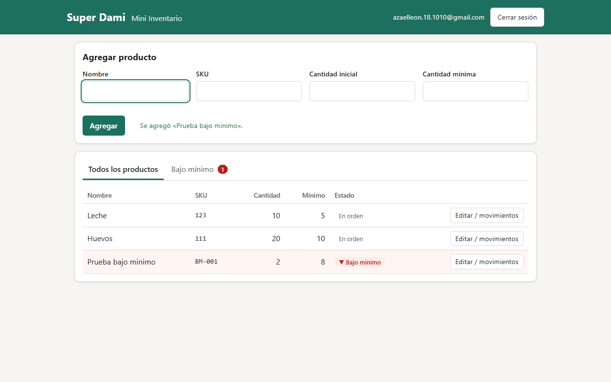
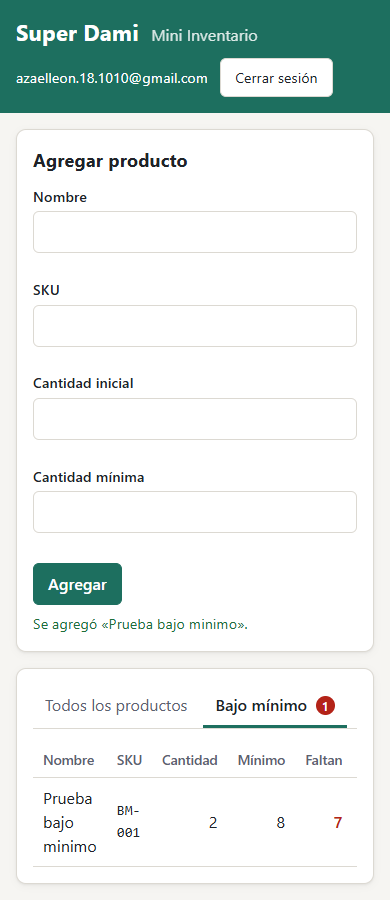
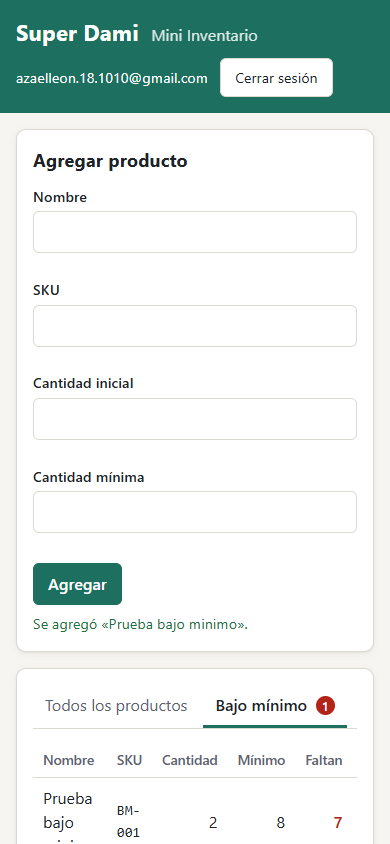
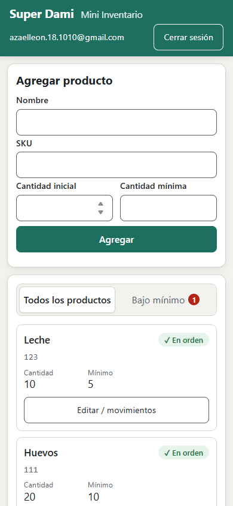
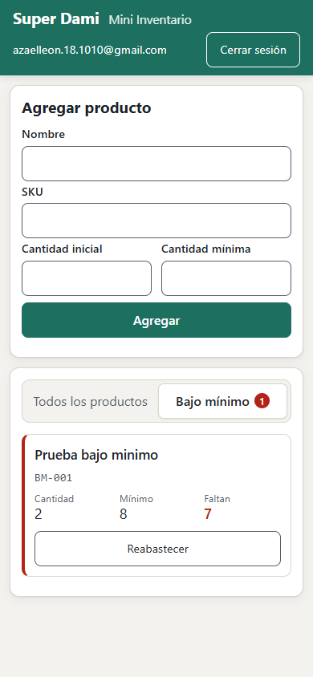
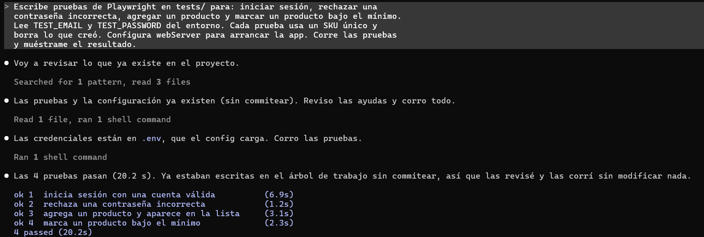
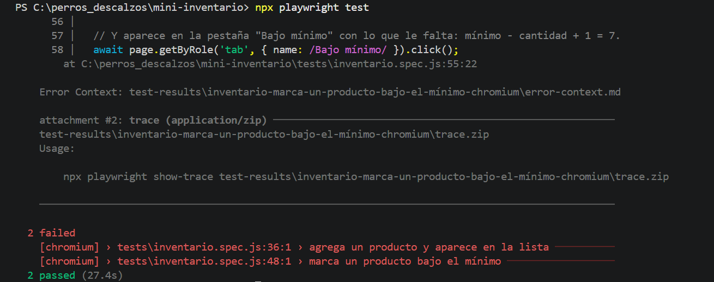
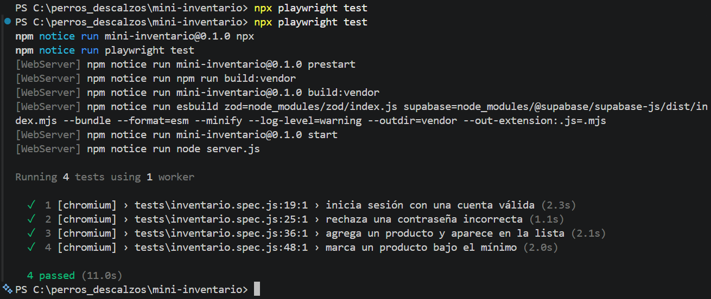

# Día 5 – Prueba tu app con los ojos del agente

## 1. Herramientas

- Rama `dia-05-pruebas`.
- `TEST_EMAIL` y `TEST_PASSWORD` en `.env` (no se suben al repositorio).
- `npm install -g @playwright/cli@latest` y la skill con
  `npx skills add https://github.com/microsoft/playwright-cli --skill playwright-cli -a claude-code -y`.
- Playwright Test con `npm init playwright@latest`.

## 2. Exploración con el agente

Prompt:

> Arranca la app. Usa playwright-cli para abrir http://localhost:3000, iniciar sesión con TEST_EMAIL y TEST_PASSWORD de .env sin mostrarlos, y agregar un producto con cantidad menor al mínimo. Toma capturas en 1280x800 y en 390x844, y revisa los errores de consola. Guarda las capturas en entregas/dia-05/ y reporta lo que encontraste. No corrijas nada todavía.

Capturas del recorrido (antes de corregir):

| Escritorio 1280x800 | Móvil 390x844 |
|---|---|
|  |  |

Otras capturas: `01-login-1280x800.png`, `03-pestana-bajo-minimo-1280x800.png` y `04-pestana-bajo-minimo-390x844.png`.

## 3. Problema real y corrección

**Problema:** al revisar las capturas en móvil vi que la tabla no cabía bien. El SKU `BM-001` se partía en dos renglones (`BM-` / `001`), el nombre ocupaba tres y el formulario llenaba toda la pantalla, así que la lista de productos quedaba muy abajo.

Prompt (resumido):

> Revisé las capturas de entregas/dia-05/. Problema principal: en móvil (390x844) la tabla está apretada [...]. Corrígelo primero. Después haz mejoras visibles a toda la interfaz [...]. No cambies la funcionalidad. Conserva los textos visibles, los label y los id de los campos, porque después escribiré pruebas de Playwright. Solo HTML y CSS, sin librerías. Antes de editar, muéstrame una lista corta de los cambios y espera mi aprobación. Al terminar, toma de nuevo las capturas con el prefijo "despues-".

**Corrección:** aprobé la lista de cambios que propuso el agente. En móvil, cada producto ahora es una tarjeta con su nombre, SKU, cantidad y mínimo, y el formulario es más compacto. También mejoraron el inicio de sesión, las insignias de estado y la ventana de editar. El cambio quedó solo en `public/css/estilos.css` (commit `4c652c8`).

| Antes (móvil) | Después (móvil) | Después: Bajo mínimo |
|---|---|---|
|  |  |  |

## 4. Pruebas permanentes

Prompt:

> Escribe pruebas de Playwright en tests/ para: iniciar sesión, rechazar una contraseña incorrecta, agregar un producto y marcar un producto bajo el mínimo. Lee TEST_EMAIL y TEST_PASSWORD del entorno. Cada prueba usa un SKU único y borra lo que creó. Configura webServer para arrancar la app. Corre las pruebas y muéstrame el resultado.

- `tests/inventario.spec.js`: las 4 pruebas.
- `tests/ayudas-e2e.js`: inicio de sesión, SKU único (`E2E-...`) y limpieza. Después de cada prueba, pase o falle, `afterEach` borra por SKU lo que esa prueba creó, usando la sesión de la usuaria de prueba (RLS solo le deja borrar lo suyo).
- `playwright.config.js`: `webServer` arranca la app con `npm start` y espera a `/health`.

## 5. Las pruebas detectan errores

Cambié a mano la comparación en `public/productos.js` (línea 34, función `estaBajoMinimo`) de `producto.cantidad <= producto.minimo` a `producto.cantidad > producto.minimo`. Fallaron 2 pruebas: "agrega un producto y aparece en la lista" (un producto con 20 de 5 salía como bajo mínimo) y "marca un producto bajo el mínimo" (uno con 2 de 8 ya no tenía la insignia).

Regresé la línea a `<=`, volví a correr `npx playwright test` y pasaron las 4.

## 6. Bitácora

**Prompts clave:** los de las secciones 2, 3 y 4.

**Error de la IA:** para agregar `test-results/` y `playwright-report/` al `.gitignore`, el agente reescribió el archivo completo con saltos de línea de Windows (CRLF). Git marcaba todo el archivo como cambiado (+41 −40) cuando solo eran 3 líneas nuevas. Lo detecté con `git diff --stat` y lo corregí regresando los saltos de línea a LF. Después el diff solo muestra las líneas nuevas.

**Comando o herramienta que aprobé:** la lista de cambios a la interfaz que propuso el agente antes de editar. La revisé para confirmar que no tocaba la lógica, los textos ni los `id` que usan las pruebas, y después la aprobé.

**Cómo comprobé que funciona:** comparé las capturas de antes y después en 1280x800 y 390x844, corrí `npx playwright test` (4 passed), provoqué una falla (2 failed) y confirmé que al revertir vuelven a pasar las 4. Las pruebas borran los productos que crean, así que no dejan datos de prueba.
