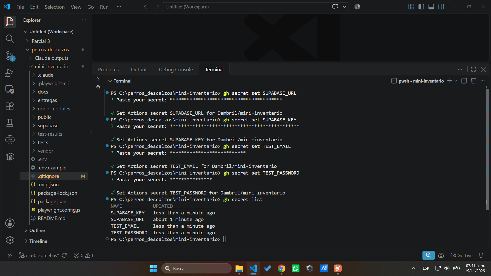
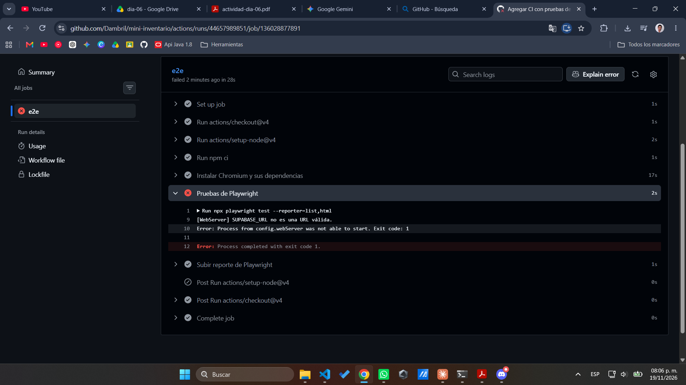
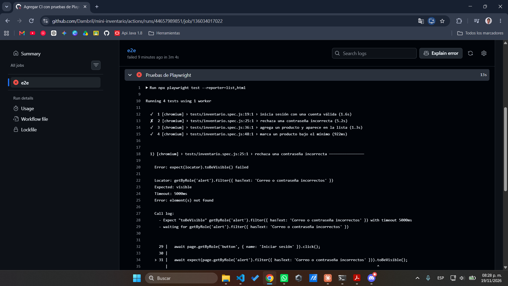
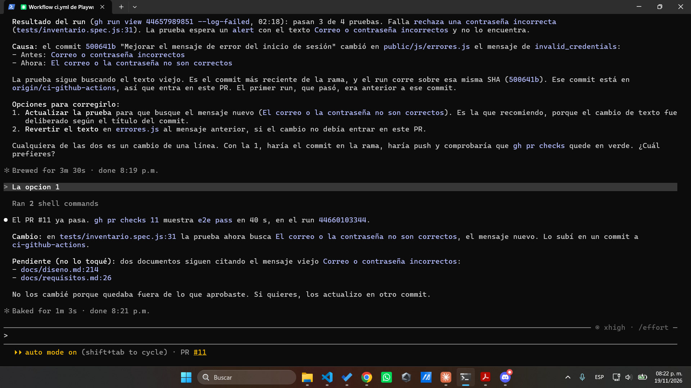
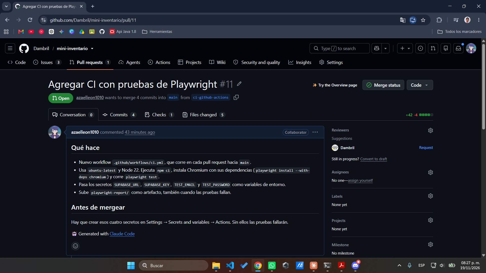

# Día 6 – Automatiza las pruebas con GitHub Actions

Pull request: https://github.com/Dambril/mini-inventario/pull/11

## 1. Flujo de CI

Prompt:

> Crea .github/workflows/ci.yml para que en cada pull request hacia main se ejecute en ubuntu-latest con Node 22: npm ci, instalación de Chromium con sus dependencias y las pruebas de Playwright. Pasa como variables de entorno los secretos SUPABASE_URL, SUPABASE_KEY, TEST_EMAIL y TEST_PASSWORD. Sube el reporte de Playwright como artefacto. Después abre un pull request con gh.

`.github/workflows/ci.yml` se ejecuta con `on: pull_request` hacia `main`. Usa `ubuntu-latest` y Node 22, corre `npm ci`, instala Chromium con `npx playwright install --with-deps chromium`, corre las pruebas y sube `playwright-report/` como artefacto, aunque las pruebas fallen.

## 2. Secretos

Guardé los cuatro secretos yo mismo con `gh secret set`, escribiendo cada valor en la terminal, sin pegarlos en la conversación con el agente. En el workflow solo aparecen como referencias:

```yaml
env:
  SUPABASE_URL: ${{ secrets.SUPABASE_URL }}
  SUPABASE_KEY: ${{ secrets.SUPABASE_KEY }}
  TEST_EMAIL: ${{ secrets.TEST_EMAIL }}
  TEST_PASSWORD: ${{ secrets.TEST_PASSWORD }}
```



## 3. De verde a rojo y otra vez a verde (mismo PR #11)

1. **Verde:** el primer run del PR pasó las 4 pruebas.
2. **Cambio que rompe:** subí el commit `500641b`, "Mejorar el mensaje de error del inicio de sesión". En `public/js/errores.js` cambié *"Correo o contraseña incorrectos"* por *"El correo o la contraseña no son correctos"*.
3. **Rojo, falla 1:** el servidor no arrancaba (`SUPABASE_URL no es una URL válida`) y no corrió ninguna prueba.
   
4. **Rojo, falla 2:** después de corregir los secretos pasaron 3 de 4 pruebas. Falló "rechaza una contraseña incorrecta".
   
5. **Verde:** se actualizó la prueba al mensaje nuevo y el PR volvió a pasar (`gh pr checks 11`: e2e pass).
   

## 4. Diagnóstico con gh

Prompt (sin dar pistas):

> Las verificaciones de este pull request fallaron. Usa gh pr checks, gh run list y gh run view con --log-failed para encontrar la causa. Explícamela antes de corregir. Cuando la apruebe, corrige, sube el cambio y comprueba que todo pase.

El agente usó `gh pr checks`, `gh run list`, `gh run view --log-failed` y `gh run rerun --failed`. Encontró tres causas, una tras otra:

- [Diagnóstico 1: SUPABASE_URL](03-diagnostico-1-supabase-url.png)
- [Diagnóstico 2: SUPABASE_KEY](04-diagnostico-2-supabase-key.png)
- [Diagnóstico 3: el mensaje de la prueba](06-diagnostico-3-mensaje.png)

**La causa, con mis palabras:** al guardar los secretos con `gh secret set` intercambié los valores. En `SUPABASE_URL` quedó la llave y en `SUPABASE_KEY` quedó la URL. Como `server.js` valida los dos antes de arrancar, el servidor no levantaba y Playwright no podía correr ninguna prueba. Cuando volví a guardar los secretos bien, apareció la falla que yo había provocado: la prueba buscaba el texto exacto *"Correo o contraseña incorrectos"* y la app ya mostraba el mensaje nuevo. Elegí quedarme con el mensaje nuevo y actualizar la prueba. También se actualizaron `docs/diseno.md` y `docs/requisitos.md` para que coincidan.

## 5. Bitácora

**Prompts clave:** el del paso 3 (crear el workflow) y el del paso 4 (diagnóstico con gh).

**Error de la IA:** la actividad pedía trabajar en la rama `dia-06-ci`, pero el agente creó la suya, `ci-github-actions`, y abrió el PR #11 desde ahí. Lo detecté al revisar el PR, que dice "from ci-github-actions". Como un PR no puede cambiar de rama, y el verde y el rojo ya estaban en el #11, seguí con ese PR. La rama `dia-06-ci` quedó sin usar.

**Comandos aprobados y rechazados:**
- Aprobé que el agente relanzara los runs con `gh run rerun --failed` después de que yo volviera a guardar los secretos.
- Rechacé que el agente guardara los secretos por mí ("pásame el valor"). Los guardé yo para que las llaves nunca pasaran por la conversación.
- Rechacé agregar al workflow un paso extra para validar los secretos, porque `server.js` ya da un mensaje claro, y gracias a él se encontró la causa.
- Aprobé la opción 1: actualizar la prueba al mensaje nuevo en lugar de revertirlo.

**Cómo comprobé que funciona:** `gh pr checks 11` muestra *e2e pass* en el mismo PR que antes falló. Revisé los logs de los runs fallidos y el que pasó, y en `gh secret list` se ven los cuatro secretos sin mostrar sus valores.


