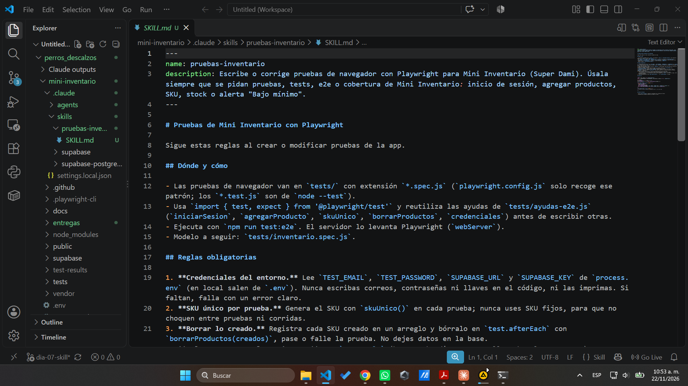
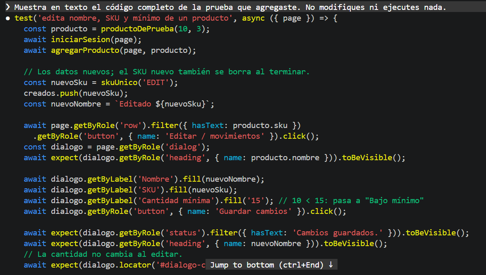
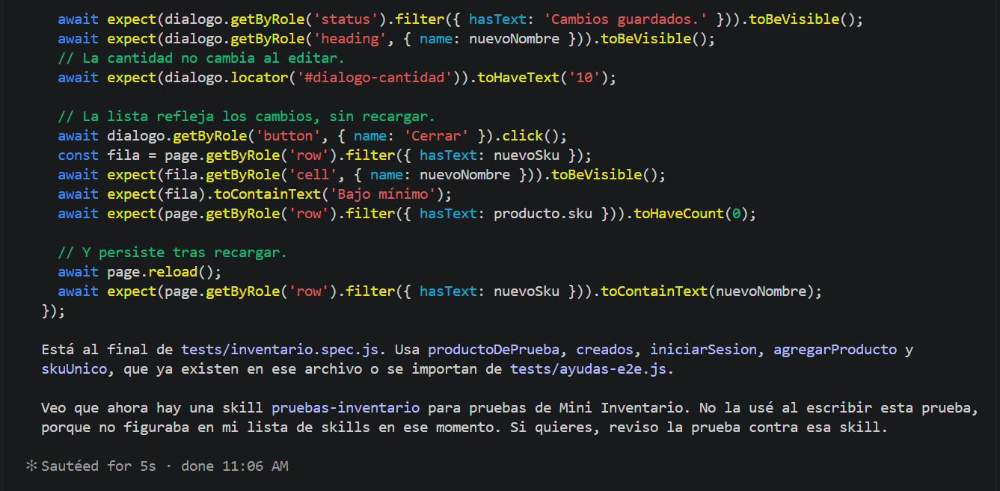
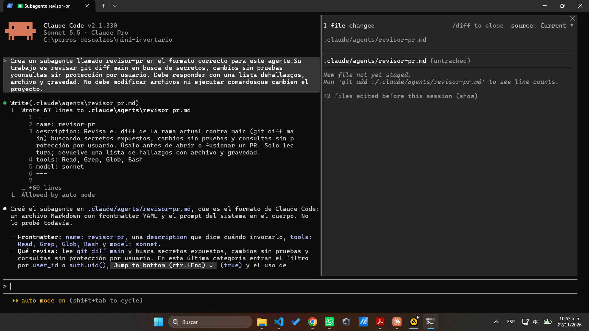
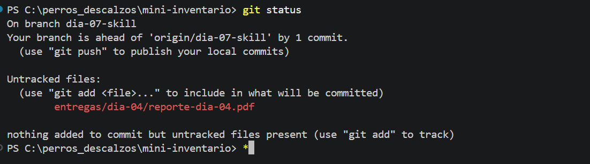
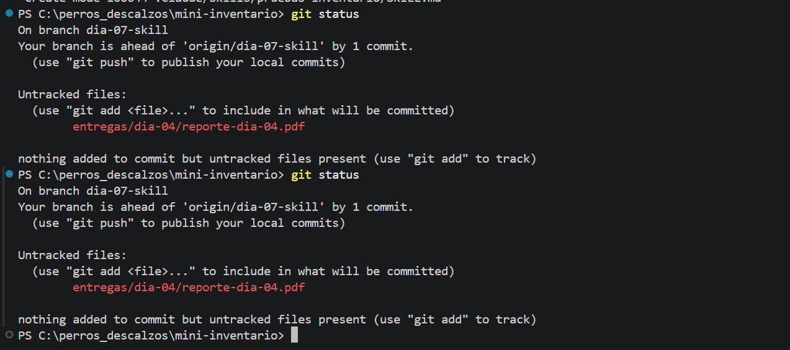
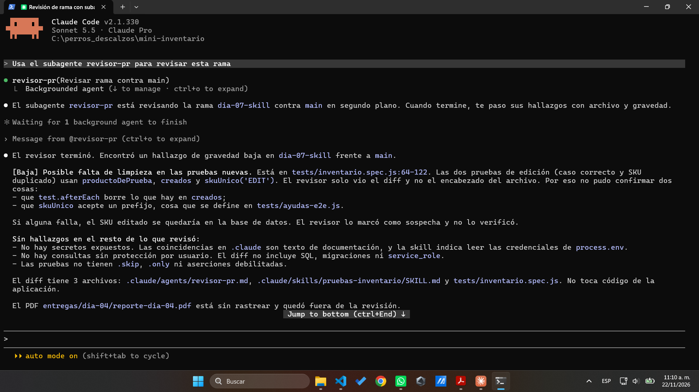
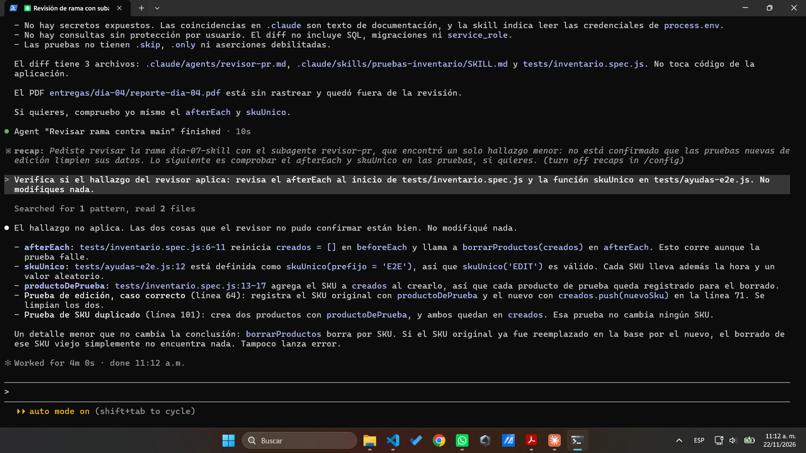

# Día 7 – Enséñale a tu agente cómo trabaja tu proyecto

## 1. Skill `pruebas-inventario`

Ruta: `.claude/skills/pruebas-inventario/SKILL.md`

Prompt:

> Crea una skill llamada pruebas-inventario en la ruta correcta para este agente. Debe indicar: usar Playwright en tests/, leer credenciales del entorno, usar un SKU único por prueba, borrar lo creado, seleccionar elementos por rol o etiqueta, y cubrir el caso correcto y un caso de error. La descripción debe activarse cuando se pidan pruebas de Mini Inventario.

- **Descripción** (cuándo se activa): cuando se pidan pruebas, tests, e2e o cobertura de Mini Inventario, como inicio de sesión, productos, SKU, stock o "Bajo mínimo".
- **Reglas concretas:**
  1. Credenciales desde `process.env`, nunca escritas en el código.
  2. SKU único con `skuUnico()`.
  3. Borrar lo creado en `test.afterEach` con `borrarProductos(creados)`.
  4. Selectores con `getByRole` y `getByLabel`, sin CSS.
  5. Un caso correcto y un caso de error.
  6. Aserciones web-first, sin `waitForTimeout`.
- Incluye una plantilla y pide correr `npm run test:e2e` antes de terminar.

## 2. Comparación: mismo pedido sin skill y con skill

Pedido, en una conversación limpia cada vez: **«Escribe una prueba de Playwright para editar un producto»**

| | Sin skill (paso 1) | Con skill (paso 3) |
|---|---|---|
| ¿Se activó la skill? | No. El agente dijo después que la skill "no figuraba en su lista de skills" | Sí: aparece `Skill(...)` / *Loaded skill* |
| Pruebas escritas | 1: "edita nombre, SKU y mínimo de un producto" | 2: la misma prueba de edición **+ "rechaza editar un producto con un SKU que ya existe"** |
| Caso de error | ❌ No lo incluyó | ✅ SKU duplicado: revisa `aria-invalid`, el mensaje y que no se guarde nada |
| SKU único y borrar lo creado | ✅ Usó `skuUnico` y `creados`, porque copió el estilo del archivo existente | ✅ Igual, y lo exige la regla 2 y 3 de la skill |
| Selectores por rol o etiqueta | Casi todos, pero usa `locator('#dialogo-cantidad')` (CSS) | **Sigue igual**: conserva `#dialogo-cantidad` sin explicar por qué, aunque la regla 4 lo prohíbe |
| Dónde la escribió | Al final de `tests/inventario.spec.js` | En el mismo archivo |

**Qué mejoró:** con la skill, el agente agregó solo el caso de error que pide la regla 5. Sin la skill solo cubrió el caso feliz, y ese caso lo habría tenido que pedir yo aparte.

**Qué sigue mal:** el selector CSS `#dialogo-cantidad` aparece en las dos versiones. La regla existe, pero el agente no la aplicó a la parte que ya venía escrita.

**Cuánto tuve que corregir:** sin skill, faltaba una prueba completa, la del caso de error. Con skill, solo queda un selector.

**Nota honesta:** la prueba del paso 1 se agregó a un archivo que ya existía, `tests/inventario.spec.js`. Al descartarla borré el archivo completo mientras el agente del paso 3 ya lo había leído, y el agente lo volvió a escribir con lo que había leído. Por eso la prueba de edición quedó igual en los dos intentos, y la diferencia real que aportó la skill es el caso de error. Comprobé con `git diff` que las 4 pruebas originales quedaron intactas y solo se agregaron las 2 nuevas.

Código del paso 1, recuperado con `claude --resume`:

Capturas de los intentos: [sin skill](03-sin-skill.png) · [con skill](06-con-skill.png)

## 3. Subagente `revisor-pr`

Ruta: `.claude/agents/revisor-pr.md`, con `name`, `description`, `tools: Read, Grep, Glob, Bash` y `model: sonnet`.

Prompt:

> Crea un subagente llamado revisor-pr en el formato correcto para este agente. Su trabajo es revisar git diff main en busca de secretos, cambios sin pruebas y consultas sin protección por usuario. Debe responder con una lista de hallazgos, archivo y gravedad. No debe modificar archivos ni ejecutar comandos que cambien el proyecto.

Sus instrucciones son de solo lectura:
- Prohíben escribir archivos, las redirecciones y `sed -i`.
- Solo permiten comandos de lectura de git (`git diff main`, `git log`, `git show`, `git status`).
- Prohíben `commit`, `push`, `checkout`, `reset`, instalar dependencias y correr pruebas.

## 4. Ejecución sobre la rama

Hice commit de la skill, el subagente y las pruebas, para que aparecieran en `git diff main`. Luego pedí: **«Usa el subagente revisor-pr para revisar esta rama»**.

| Antes | Después |
|---|---|
|  |  |

`git status` es idéntico antes y después: el revisor no cambió nada.

**Hallazgo:** *[Baja] Posible falta de limpieza en las pruebas nuevas* (`tests/inventario.spec.js:64-122`). El revisor no pudo confirmar que `afterEach` borre lo creado ni que `skuUnico` acepte un prefijo.

## 5. Atender el hallazgo: no aplica

Pedí verificarlo sin modificar nada. **El hallazgo no aplica:**
- `test.afterEach` sí llama a `borrarProductos(creados)` (`tests/inventario.spec.js:6-11`).
- `skuUnico` está definida como `skuUnico(prefijo = 'E2E')` (`tests/ayudas-e2e.js:12`), así que `skuUnico('EDIT')` es válido.
- Las dos pruebas nuevas registran todos sus SKU en `creados`.

El revisor solo veía el diff, y esas líneas no cambiaron. Por eso, como dicen sus instrucciones, lo marcó como sospecha de gravedad baja en lugar de inventar un problema. No agregué código para "arreglarlo".

## 6. Bitácora

**Prompts clave:** el de la skill, el del subagente, el pedido «Escribe una prueba de Playwright para editar un producto» (dos veces) y «Usa el subagente revisor-pr para revisar esta rama».

**Error de la IA:** en `revisor-pr.md` el agente escribió *"No tienes herramientas de escritura"*, pero le dio la herramienta `Bash`, que sí puede modificar archivos. Que sea de solo lectura depende de sus instrucciones, no de sus herramientas. Lo detecté al leer el frontmatter (`tools: Read, Grep, Glob, Bash`). Lo dejé así porque necesita Bash para correr `git diff main`, y lo comprobé con `git status` antes y después: no cambió nada.

**Comando o herramienta que rechacé:** rechacé aplicar una corrección por el hallazgo del revisor. Primero pedí verificarlo sin modificar nada y resultó que no aplicaba, así que cambiar el código habría sido agregar algo innecesario.

**Cómo comprobé que funciona:**
- La línea `Skill(...)` confirma que la skill se activó en el segundo intento.
- La comparación de código muestra el caso de error nuevo.
- `git status` es igual antes y después del revisor.
- `git diff` confirma que las pruebas originales siguen intactas.
- El CI del pull request corre todas las pruebas, incluidas las 2 nuevas.
