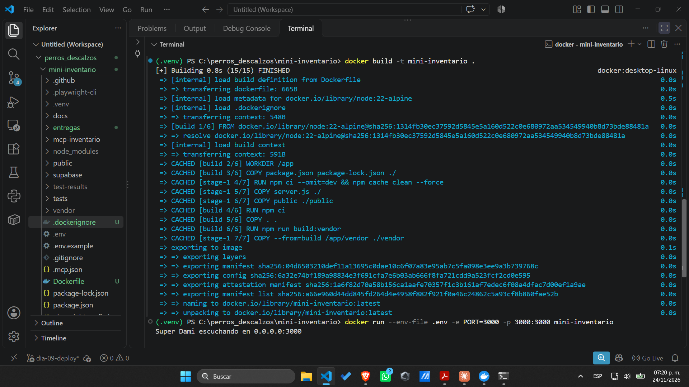
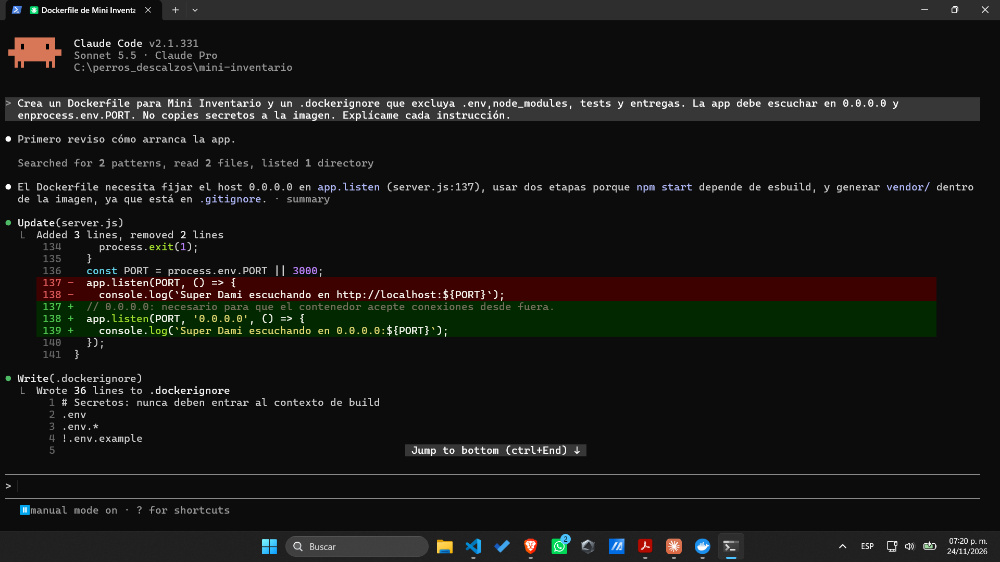
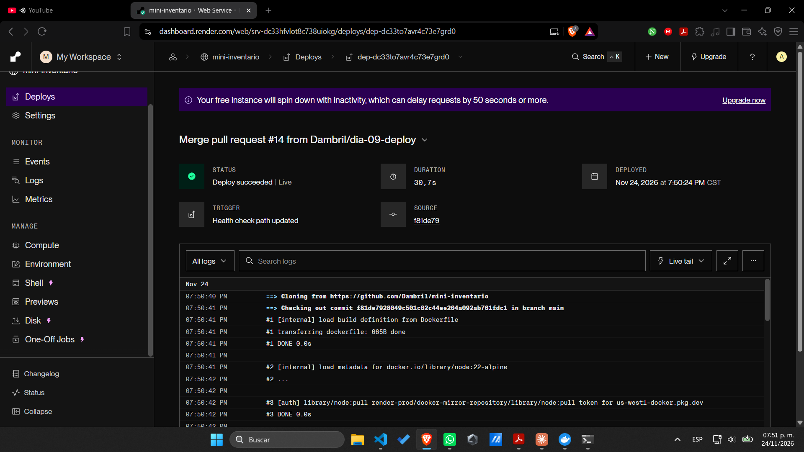
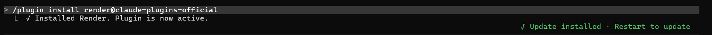
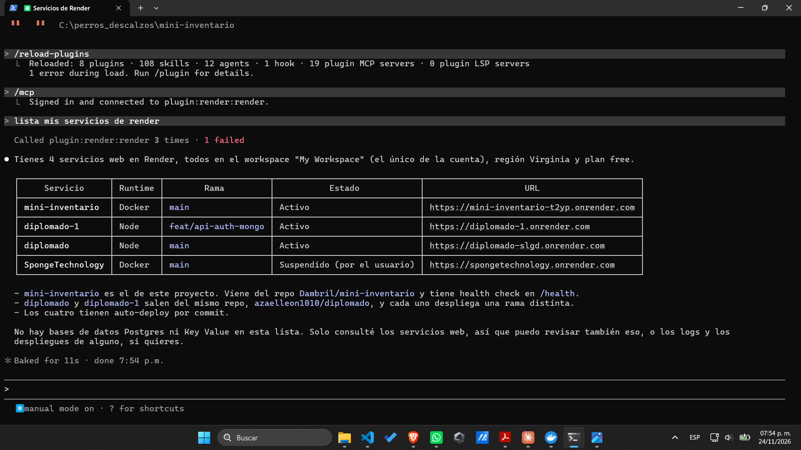
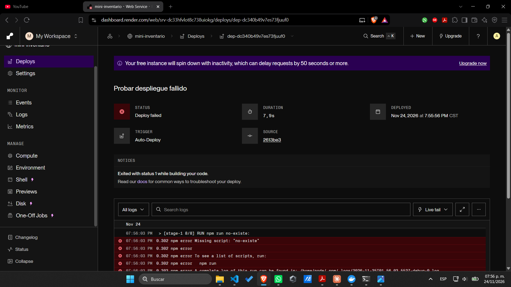
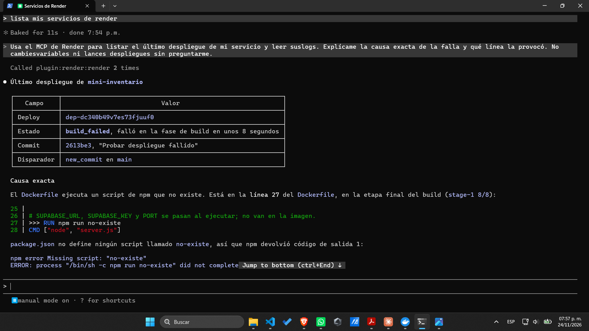
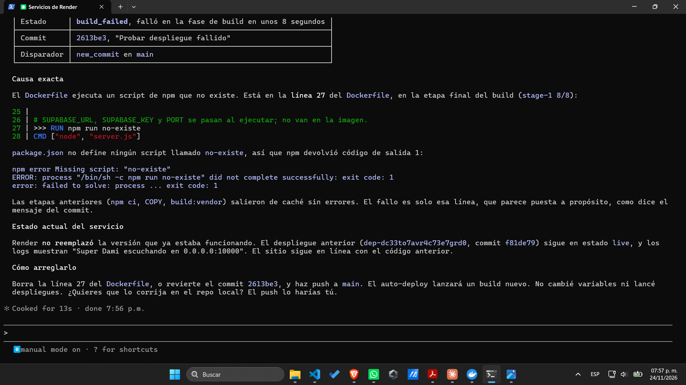
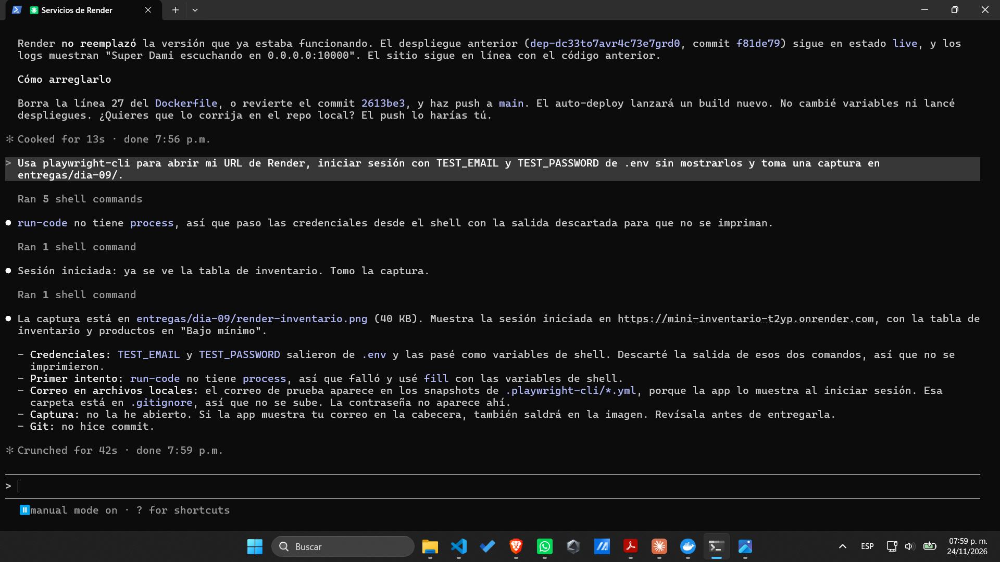
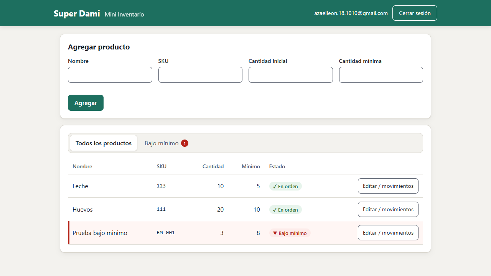

# Día 9 – Publica tu app y diagnostica un despliegue fallido

**URL pública:** https://mini-inventario-t2yp.onrender.com

## 1. Contenedor en local

Prompt:

> Crea un Dockerfile para Mini Inventario y un .dockerignore que excluya .env, node_modules, tests y entregas. La app debe escuchar en 0.0.0.0 y en process.env.PORT. No copies secretos a la imagen. Explícame cada instrucción.

El agente revisó primero cómo arranca la app y creó un **Dockerfile de dos etapas**:
- **`build`:** `npm ci` con dependencias de desarrollo y `npm run build:vendor`. La carpeta `vendor/` se genera con `esbuild` y no está en Git.
- **Imagen final:** `npm ci --omit=dev`, copia solo `server.js`, `public/` y `vendor/`, corre como `USER node` y arranca con `CMD ["node", "server.js"]`.

También cambió `server.js` para escuchar en `0.0.0.0` con `process.env.PORT`.

`.dockerignore` excluye `.env` y `.env.*`, `node_modules`, `tests`, `entregas`, `.git`, `.claude`, `.mcp.json`, `.venv`, `mcp-inventario`, entre otros. Ningún secreto entra a la imagen: `SUPABASE_URL` y `SUPABASE_KEY` se pasan al ejecutar.

```powershell
docker build -t mini-inventario .
docker run --env-file .env -e PORT=3000 -p 3000:3000 mini-inventario
```

Resultado: `Super Dami escuchando en 0.0.0.0:3000`.




PR del contenedor: https://github.com/Dambril/mini-inventario/pull/14

## 2. Servicio en Render

New → Web Service, con el repositorio `Dambril/mini-inventario`, **Language: Docker**, **plan Free**, **Auto-Deploy: On Commit** y **Health Check Path: `/health`**. Las variables `SUPABASE_URL` y `SUPABASE_KEY` (la llave publishable) están en **Environment**, en el panel de Render, no en el código. `PORT` lo asigna Render (10000).



**Problemas que tuve que diagnosticar antes de llegar a *Live*:**
1. **El health check no pasaba.** El log decía `Super Dami escuchando en http://localhost:10000`, el mensaje del código viejo. El commit del paso 1 solo incluía `Dockerfile` y `.dockerignore`, y el cambio de `server.js` (escuchar en `0.0.0.0`) se quedó sin subir. Lo subí en otro commit al PR #14.
2. **La ruta del health check estaba mal escrita:** `/healt` en lugar de `/health`. La app respondía 404 y Render seguía esperando. La corregí en Settings → Health Checks y volví a desplegar.

## 3. MCP de Render

Instalé el plugin oficial en Claude Code, que conecta el MCP con OAuth sin manejar ninguna API key:

```text
/plugin install render@claude-plugins-official
/reload-plugins
```

`/mcp` muestra *connected to plugin:render:render*. Con «lista mis servicios de render» aparecieron mis servicios, y `mini-inventario` en la rama `main` con health check en `/health`.




## 4. Falla provocada y diagnóstico con el MCP

Agregué `RUN npm run no-existe` al Dockerfile directo en `main` (commit `2613be3`). Render lanzó el auto-deploy y falló: *Deploy failed — Exited with status 1 while building your code*.



Prompt (en manual mode):

> Usa el MCP de Render para listar el último despliegue de mi servicio y leer sus logs. Explícame la causa exacta de la falla y qué línea la provocó. No cambies variables ni lances despliegues sin preguntarme.

**Diagnóstico del agente:**
- Despliegue `dep-dc340b49v7es73fjuuf0`, estado `build_failed`, disparado por `new_commit` en `main`.
- **Causa exacta:** la **línea 27 del Dockerfile**, `RUN npm run no-existe`, en la etapa final (`stage-1 8/8`). `package.json` no tiene un script llamado `no-existe`, así que npm devolvió `npm error Missing script: "no-existe"` y salió con código 1.
- Render **no reemplazó** la versión que ya funcionaba: el despliegue anterior (`f81de79`) seguía en *live*.
- **No cambió variables ni lanzó despliegues.** Ofreció corregir el repo, pero no acepté: lo corregí yo.

**La causa, con mis palabras:** el build de Docker ejecuta cada `RUN`, y si uno falla se detiene la imagen completa. Pedí un script que no existe en `package.json`, así que npm falló, Render no pudo construir la imagen y dejó en línea la versión anterior.




## 5. Reparación y verificación

Quité la línea y la subí a `main` (commit `0ee0ebd`). Render desplegó la versión corregida. Después pedí:

> Usa playwright-cli para abrir mi URL de Render, iniciar sesión con TEST_EMAIL y TEST_PASSWORD de .env sin mostrarlos y toma una captura en entregas/dia-09/.

El agente inició sesión en la URL pública y guardó la captura. Además, `https://mini-inventario-t2yp.onrender.com/health` responde `{"status":"ok"}`.




## 6. Bitácora

**Prompts clave:** el del Dockerfile (paso 1), «lista mis servicios de render», el del diagnóstico con el MCP (paso 4) y el de la verificación con playwright-cli (paso 5).

**Error de la IA:** en la verificación, el primer intento del agente falló porque usó `process.env` dentro de `playwright-cli run-code`, donde no existe `process`. Lo corrigió pasando las credenciales como variables del shell, sin mostrar la salida. También avisó que el correo de prueba queda en los archivos `.playwright-cli/*.yml`, que están en `.gitignore`. Lo detecté porque en su respuesta dice "Primer intento… falló".

**Comando aprobado o rechazado:** trabajé en *manual mode*. Aprobé solo las llamadas de lectura del MCP de Render (listar despliegues y leer logs). Cuando el agente ofreció corregir el Dockerfile, **no acepté su oferta** y lo arreglé yo con un commit, porque la actividad pide no lanzar despliegues desde el agente y aprobar cada uno manualmente.

**Cómo comprobé que funciona:**
- `docker run` local mostró *escuchando en 0.0.0.0:3000*.
- Render muestra *Deploy succeeded | Live*.
- El agente inició sesión en la URL pública con playwright-cli.
- `/health` responde `{"status":"ok"}`.
- `.dockerignore` excluye `.env` y las llaves están en el panel de Render.
